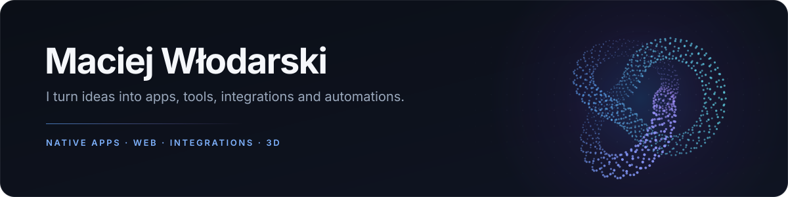

<h1 align="center"></h1>

  I build apps, tools, and experiences that make complex things easier to use.

  <a href="https://maciejwlodarski.com">Website</a> &nbsp;·&nbsp;
  <a href="mailto:me@maciejwlodarski.com">Email</a> &nbsp;·&nbsp;
  <a href="https://x.com/ZireaelGG">X / Zireael</a>

I'm interested in the whole journey from an idea to something people can use:
the interface, the underlying systems, and the details that connect them. My
work spans native macOS apps, real-time communication, web products, 3D,
integrations, and data visualisation.

### Selected projects

**[Burrow](https://github.com/MaciejWlodarski/burrow)** · Swift, SwiftUI, AppKit 
A native macOS file manager with dual-pane browsing, indexed search, and disk analysis.

**[Gwar](https://github.com/MaciejWlodarski/gwar)** · Rust, web, desktop 
A self-hosted voice communicator with browser and desktop clients and developing TeamSpeak compatibility.

**[MCPM](https://github.com/MaciejWlodarski/mcpm)** · TypeScript, Node.js 
A package manager and launcher for Minecraft: Java Edition mod profiles.

**[Personal website](https://github.com/MaciejWlodarski/maciejwlodarski.com)** · TanStack Start, React, Tailwind CSS 
My portfolio, with interactive demos for 3D point clouds and data visualisation.

### Beyond the repos

I also work on 3D workflows and product personalisation for **STUDIO 3D**,
and publish esports data analyses as [Zireael](https://x.com/ZireaelGG).

Have an idea, a small improvement, or a bigger project? [Get in touch](mailto:me@maciejwlodarski.com).
